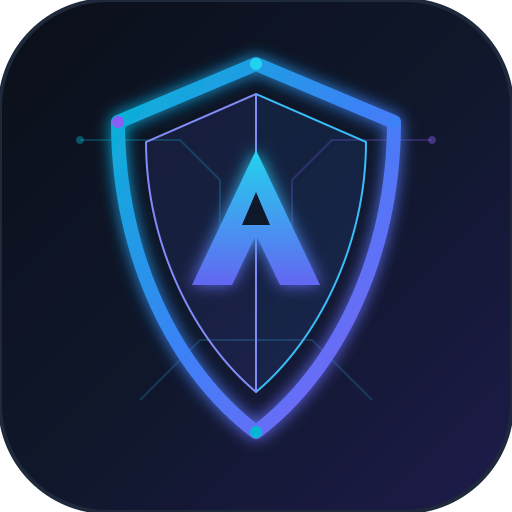

<div align="center">



# AegisRE

**Next-Generation Reverse Engineering Engine & Autonomous Agent Protocol**

_Analyze binaries, reconstruct application graphs, and bridge decompilers directly into AI agent workflows._

[](https://github.com/iammrwrath/AegisRE/releases)
[](LICENSE)
[](https://github.com/iammrwrath/AegisRE/releases)

[Downloads](#-downloads--installation) •
[Desktop GUI Studio](#-aegisre-desktop-gui-studio) •
[Features](#-key-features) •
[Quickstart](#-quickstart) •
[MCP Server Integration](#-mcp-server-for-ai-agents) •
[CLI Commands](#-cli-reference)

</div>

---

## 🛡️ Overview

**AegisRE** is a standalone, agent-ready reverse engineering platform that provides unified static inspection, deep decompilation, application reconstruction, and cryptographic Evidence tracking through a modern **Desktop GUI Studio**, a high-performance **CLI**, and a standard **Model Context Protocol (MCP)** server.

Built for both human security analysts and autonomous AI coding agents, AegisRE unifies native binary analysis (PE, ELF, Mach-O), managed .NET assemblies, Electron/JavaScript bundles, Android packages, and bridge connectors (Ghidra, IDA Pro, Cutter/Rizin) under one structured protocol.

---

## 🖥️ AegisRE Desktop GUI Studio

AegisRE includes a dedicated graphical desktop application (**AegisRE Studio**) tailored for interactive exploration, binary inspection, and decompilation without requiring terminal commands.

### Key GUI Highlights:
- **⚡ Embedded x86_64 Disassembler**: Fast opcode, operand, and mnemonic disassembly with section address navigation.
- **🔬 Ghidra-Style C Decompiler**: Real-time high-level pseudocode generation for disassembled procedures.
- **📊 Binary Structure & Header Inspector**: Visual views of PE/ELF/Mach-O sections, imports, exports, and mitigation security flags.
- **🎨 Modern Dark & Light Mode**: Clean, customizable developer interface designed for long analysis sessions.
- **🔄 Standalone & Portable**: Available both as an installer and a zero-install portable application.

---

## 📦 Downloads & Installation

Pre-compiled, zero-dependency release packages are available on the **[Releases Page](https://github.com/iammrwrath/AegisRE/releases)**:

### Windows x64

| Package                                                                                                                                       | Type             | Description                                                                                                                      |
| --------------------------------------------------------------------------------------------------------------------------------------------- | ---------------- | -------------------------------------------------------------------------------------------------------------------------------- |
| **[AegisRE-Setup-v1.0.0-win-x64.exe](https://github.com/iammrwrath/AegisRE/releases/download/v1.0.0/AegisRE-Setup-v1.0.0-win-x64.exe)**       | **Installer**    | Standard Windows setup wizard with Start Menu & Desktop shortcuts, uninstaller, and automatic system `PATH` registration.        |
| **[AegisRE-Portable-v1.0.0-win-x64.zip](https://github.com/iammrwrath/AegisRE/releases/download/v1.0.0/AegisRE-Portable-v1.0.0-win-x64.zip)** | **Portable ZIP** | Completely self-contained archive with bundled runtime and native accelerator. Extract anywhere and launch `aegis.exe` directly. |

---

## ⚡ Key Features

- **🖥️ AegisRE Desktop GUI Studio**: Dedicated interactive graphical workspace with an embedded x86_64 disassembler, Ghidra-style C pseudocode decompiler, section browser, and light/dark theme switcher.
- **🚀 High-Performance Standalone Launcher**: Fast compiled native executable (`aegis.exe`) with zero global runtime dependencies required.
- **🤖 Native Model Context Protocol (MCP)**: Plugs directly into Claude Desktop, Cursor, Codex, Windsurf, or custom AI agents via `aegis --mcp`.
- **🔍 Multi-Target Static Analysis**:
  - **Native Binaries**: PE (Windows), ELF (Linux), Mach-O (macOS), with section headers, imports/exports, symbols, and mitigation flags.
  - **JavaScript & Electron**: Full AST parsing, IPC channel boundary mapping, and source recovery from ASAR archives.
  - **Managed Assemblies**: .NET PE/CLI member decoding, P/Invoke boundary verification, and metadata auditing.
  - **Android & Mobile**: APK and DEX manifest decoding, component hierarchy analysis, and JNI boundary inspection.
- **🔗 Decompiler & Bridge Integrations**: Unifies Ghidra, IDA Pro, Cutter, and Wabt through headless session management and standard RPC protocols.
- **📜 Immutable Evidence Chains**: Every observation, disassembly snippet, or reconstructed graph is assigned an immutable SHA-256 digest (`ev_...`) ensuring verifiable analysis provenance.

---

## 🚀 Quickstart

### 1. Verify Installation

```bash
# Check version
aegis --version

# View all 190+ analysis commands and capabilities
aegis capabilities
```

### 2. Inspect a Native Binary

Analyze headers, architecture, signatures, and sections of an executable:

```bash
aegis inspect-artifact "path/to/target.exe" --format json
```

### 3. Reconstruct an Electron or JavaScript Application

Reconstruct IPC boundaries, routes, and hidden modules directly from an ASAR package or folder:

```bash
aegis analyze-javascript-application "path/to/app.asar"
```

### 4. Search and Cross-Reference

Search strings, symbols, or trace call references across targets:

```bash
aegis search "api_secret_key"
aegis xrefs 0x140001000
```

---

## 🤖 MCP Server for AI Agents

AegisRE exposes 250+ reverse engineering tools directly to Large Language Models and AI coding assistants via MCP over stdio.

### Claude Desktop Configuration

Add AegisRE to your `claude_desktop_config.json`:

```json
{
  "mcpServers": {
    "aegis": {
      "command": "aegis",
      "args": ["--mcp"]
    }
  }
}
```

### Cursor / Codex / Windsurf

```json
{
  "mcpServers": {
    "aegis": {
      "command": "C:\\Program Files\\AegisRE\\aegis.exe",
      "args": ["--mcp"]
    }
  }
}
```

Once connected, your AI assistant can inspect binaries, navigate decompiled code, trace control flow, and audit security boundaries autonomously.

---

## 🛠️ CLI Reference

| Command Family          | Operations                                                                                |
| ----------------------- | ----------------------------------------------------------------------------------------- |
| **Artifact Inspection** | `inspect-artifact`, `audit-release-exposure`, `compare-artifacts`                         |
| **JavaScript & Web**    | `analyze-javascript-application`, `analyze-web-bundle`, `recover-javascript-sources`      |
| **Native Analysis**     | `decompile`, `search-bytes`, `read-bytes`, `xrefs`, `resolve-native-call-targets`         |
| **Managed (.NET)**      | `inspect-managed-artifact`, `inspect-managed-members`, `verify-managed-native-boundaries` |
| **Android / Mobile**    | `decode-android-resources`, `search-android-classes`, `trace-android-references`          |
| **Environment / MCP**   | `capabilities`, `setup`, `mcp`, `doctor`                                                  |

Run `aegis --help` or `aegis <command> --help` for full parameter options.

---

## 🔨 Building from Source

To build AegisRE locally:

```bash
# Clone the repository
git clone https://github.com/iammrwrath/AegisRE.git
cd AegisRE

# Install dependencies
npm ci

# Build runtime and distribution artifacts
npm run build:cached

# Run tests
npm run test:fast
```

To compile the Windows installer, open `installer.iss` in Inno Setup 6 or run:

```bash
iscc installer.iss
```

---

## 🙏 Acknowledgements & Upstream Attribution

AegisRE is derived from and builds upon the open-source work of [**morluto/rea**](https://github.com/morluto/rea) (licensed under MIT). We extend our sincere thanks and credit to the original creators and contributors of the REA project for pioneering the core unified reverse-engineering engine and agent architecture.

---

## 📄 License

Distributed under the [MIT License](LICENSE).
See [THIRD_PARTY_NOTICES.md](THIRD_PARTY_NOTICES.md) for third-party component licenses.
